# WowMart Admin

WowMart is a multi-vendor online shop, and this repository is its **admin panel**: the
private back office where the shop owner manages products, follows orders from
"pending" to "delivered", reads sales and stock reports, answers customer questions
and decides which staff can see what.

I built it during my industrial attachment at **Authentic for Technology**
(Chittagong). The layout and features follow a real production admin panel, but none of
that product's source code is used: the whole panel was written fresh in Laravel.

**Stack:** Laravel 13 · PHP 8.3+ · MySQL 8 (or MariaDB 10.4+) · plain CSS, no build step.

---

## Screenshots


| | |
|---|---|
| **Sign in** — admin-only, with one generic error for every failed attempt<br>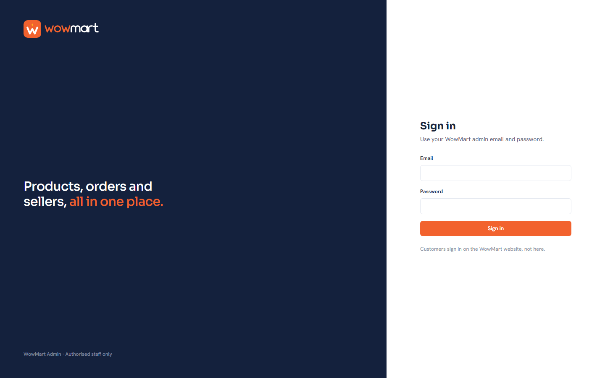 | **Dashboard** — a to-do list of what needs attention, totals and a 14-day sales chart<br>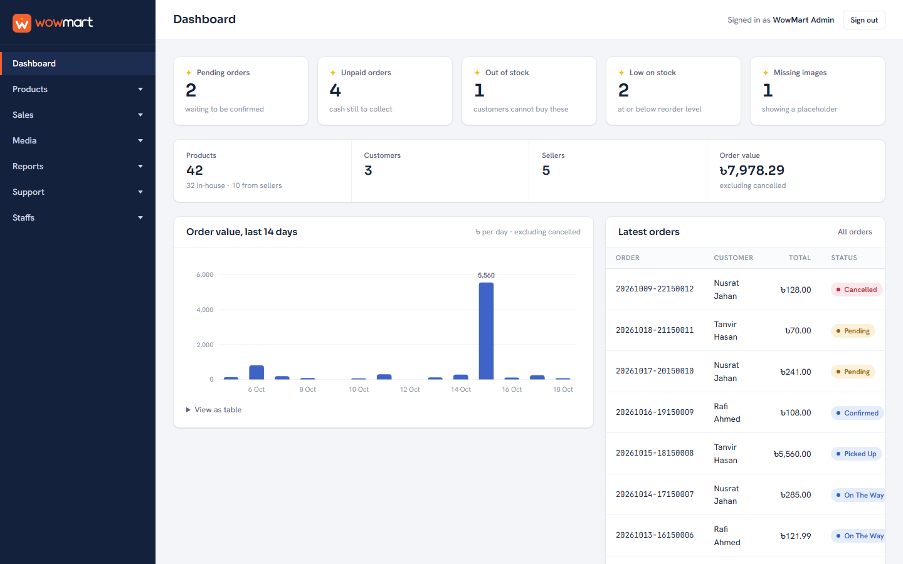 |
| **All products** — search, filters, and switches for published / featured / today's deal<br>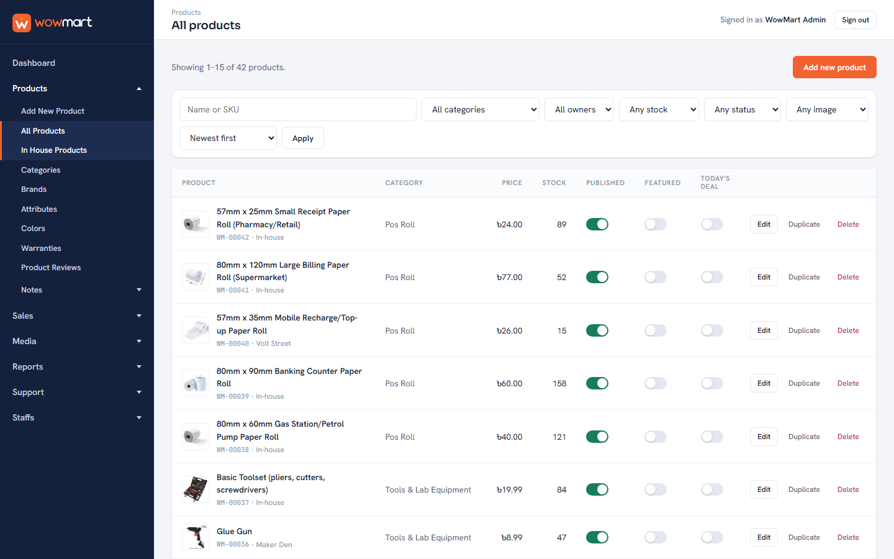 | **Product form** — one long form in seven sections, so every error shows at once<br>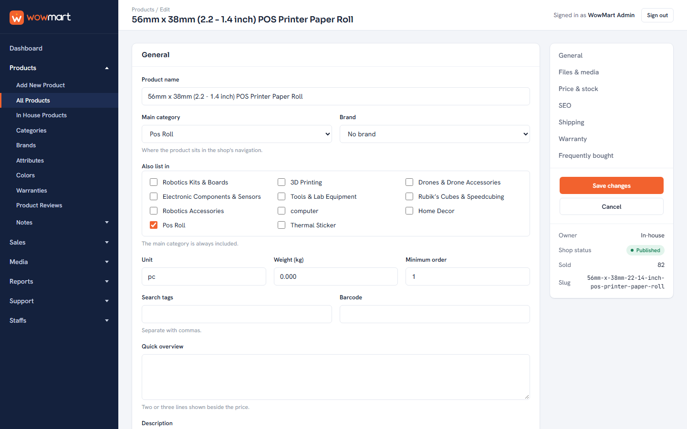 |
| **Categories** — a tree with levels, order and product counts<br>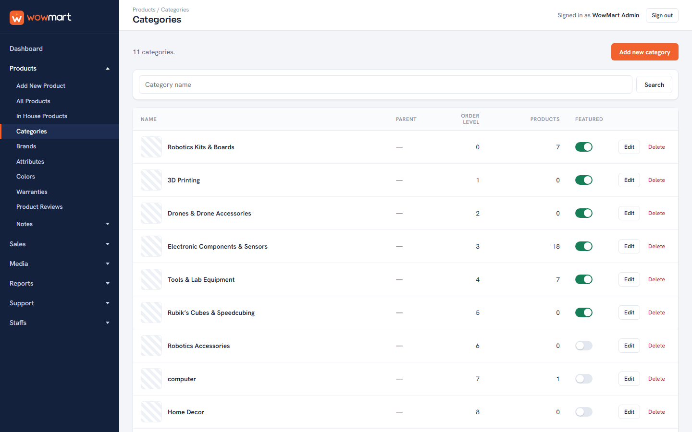 | **Brands** — list and add on one page<br>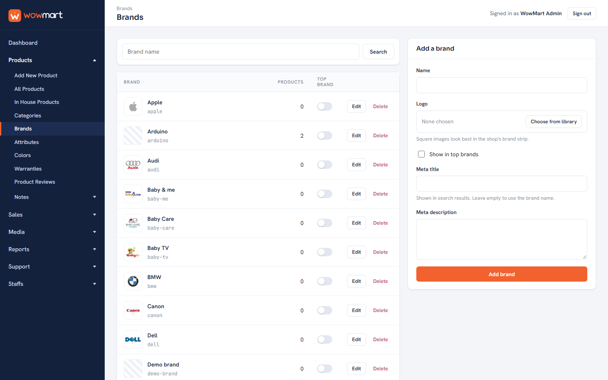 |
| **All orders** — filter by delivery status, payment status, date or customer<br>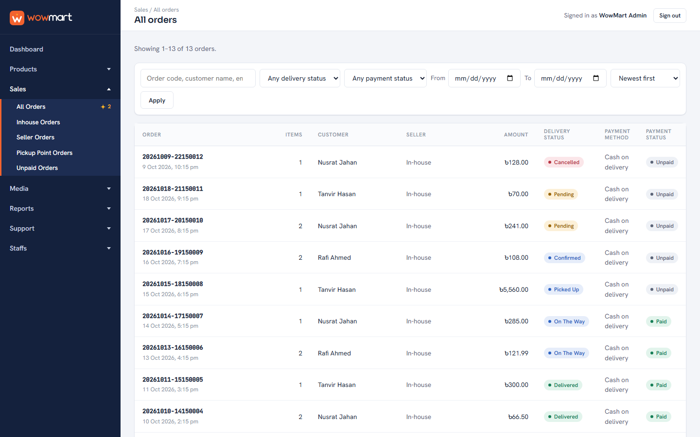 | **Order details** — lines, totals and the next allowed status steps<br>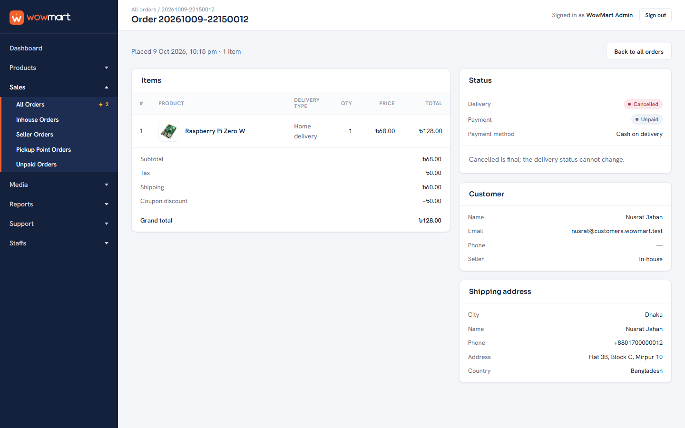 |
| **Stock report** — stock value, sold-out and low-stock products, CSV download<br>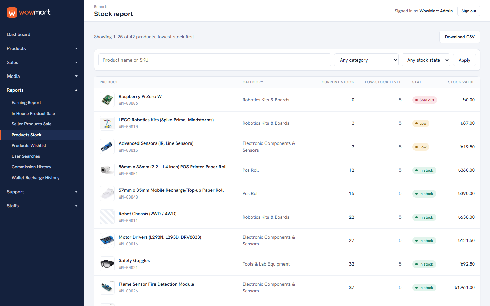 | **Product reviews** — hide or show a review; the product rating updates itself<br>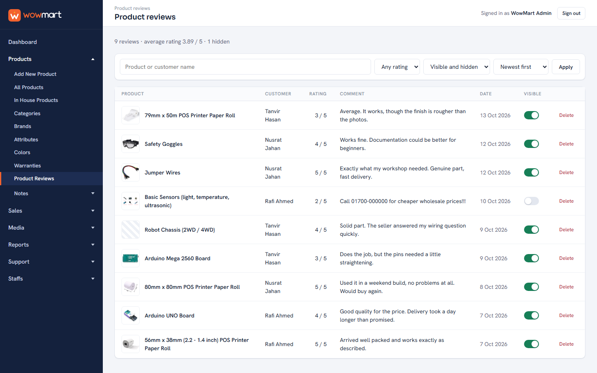 |
| **Support tickets** — customer tickets with replies and status<br>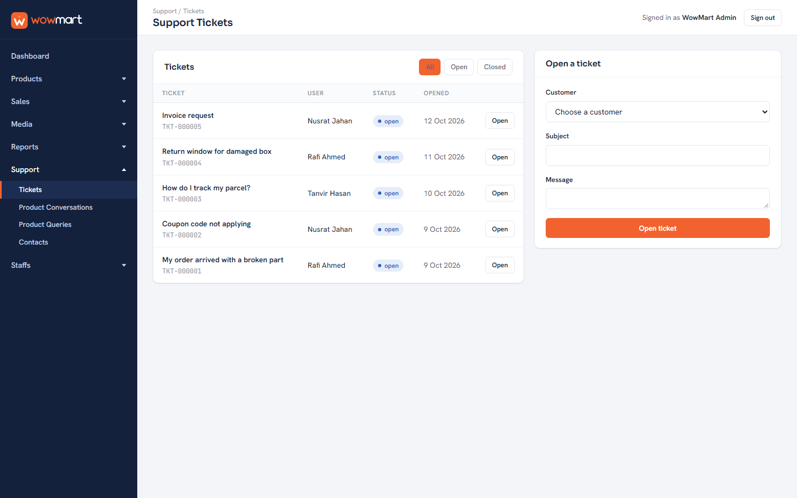 | **Staff** — staff accounts with a role each<br>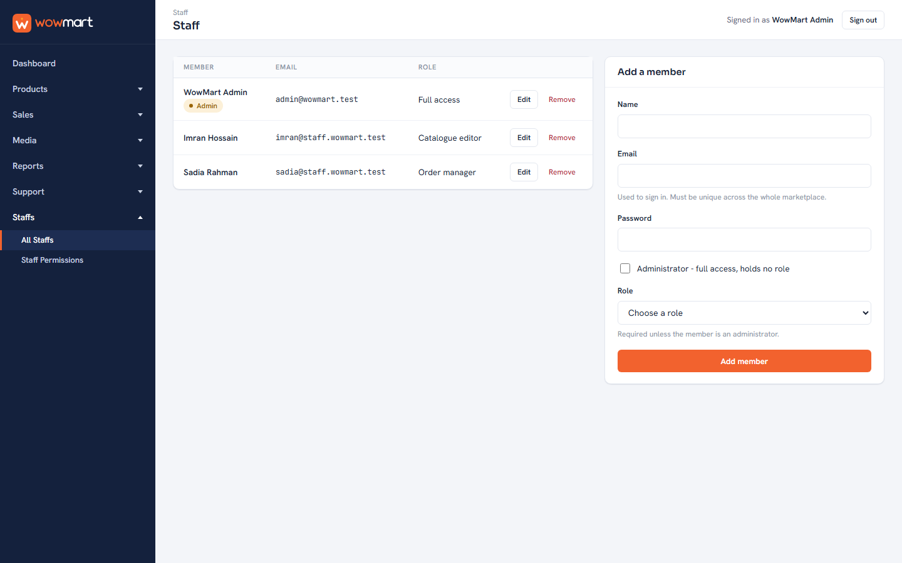 |
| **Staff permissions** — roles decide which sections a staff member can open<br>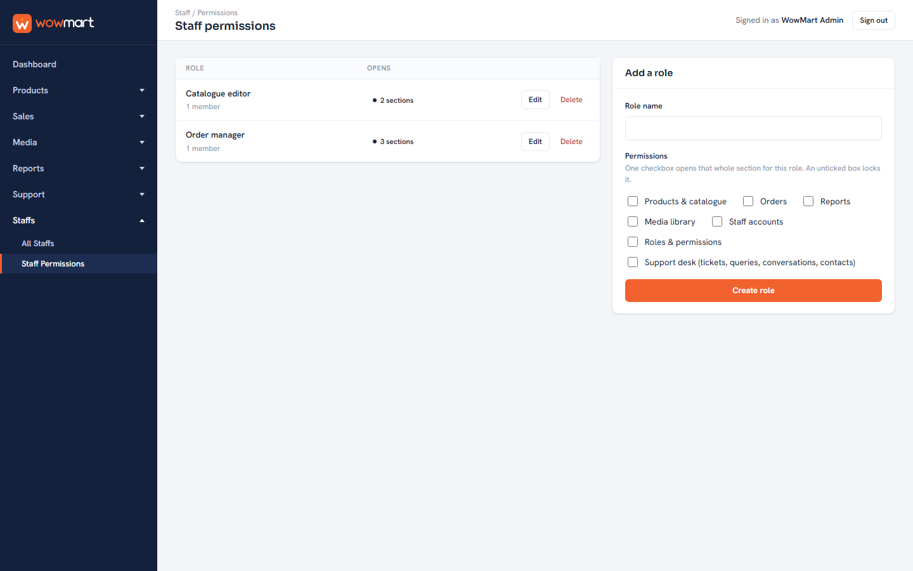 | **Uploaded files** — one media library; products and brands pick images from it<br>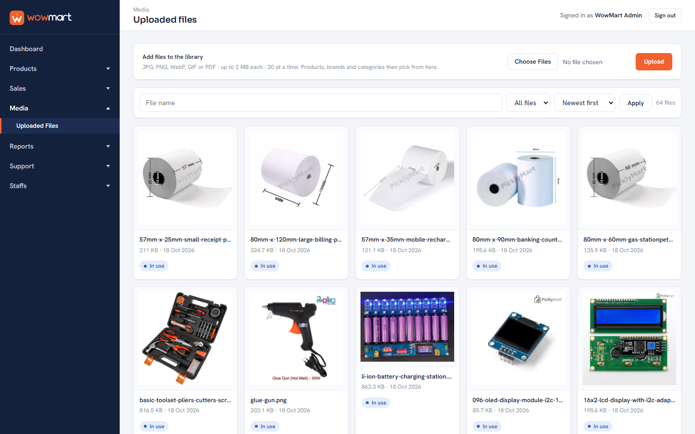 |

---

## What's inside

| Section | What you can do |
|---|---|
| **Dashboard** | See pending and unpaid orders, sold-out and low-stock products and products without images, each linking to the filtered list where you fix it. |
| **Products** | Add and edit products (price, discount window, stock, gallery, SEO, shipping, warranty), duplicate them, publish or unpublish. Manage categories, brands, attributes, colours, warranties, refund/warranty notes and product reviews. |
| **Sales** | All orders, in-house orders, seller orders, pickup-point orders and unpaid orders. Move an order through its six states (pending → confirmed → picked up → on the way → delivered, or cancelled). Cancelling puts the stock back exactly once. |
| **Media** | Upload images and PDFs once, reuse them everywhere. Files that are still in use can't be deleted. |
| **Reports** | Earnings, in-house and seller sales, stock, wishlists, what customers search for, commission history and wallet recharges, each with CSV download. |
| **Support** | Support tickets, product conversations, product questions and contact-form messages. |
| **Staffs** | Staff accounts and roles. A staff member only sees the sections their role allows. |
| **API** | Everything above is also available at `/api/v1`, protected by login tokens. |

---

## How to run it

You need four things installed:

| Tool | Version | Notes |
|---|---|---|
| **PHP** | 8.3 or newer | Laravel 13 needs it. **XAMPP's own PHP (8.2) is too old** — install PHP separately from [windows.php.net](https://windows.php.net/download/) or with [php.new](https://php.new). In `php.ini`, make sure `pdo_mysql`, `mbstring`, `openssl` and `fileinfo` are enabled (and `pdo_sqlite` if you want to run the tests). |
| **Composer** | 2.x | [getcomposer.org](https://getcomposer.org/download/) |
| **MySQL + phpMyAdmin** | MySQL 8 or MariaDB 10.4+ | The easiest way is **XAMPP**: start only **Apache** and **MySQL** from the XAMPP Control Panel. |
| **Git** | any | to download the code |

Check PHP with `php -v` — it must say 8.3 or higher.

### Step 1 — Download the code

```bash
git clone https://github.com/iparthanth/wowmart.git
cd wowmart
composer install
```

`composer install` downloads Laravel and the other libraries into a `vendor` folder.
It can take a few minutes the first time.

### Step 2 — Create the database and import the SQL file

1. Open **phpMyAdmin**: <http://localhost/phpmyadmin>
2. Click **New** in the left panel.
3. Type the database name **`wowmart`**, choose collation **`utf8mb4_unicode_ci`**, and click **Create**.
4. With `wowmart` selected on the left, open the **Import** tab.
5. Click **Choose File** and pick **`database/sql/wowmart.sql`** from the project folder.
6. Scroll down and click **Import** (or **Go**).

You should see a green "Import has been successfully finished" message and 34 tables
on the left. The file already contains the demo data: 42 products, 29 brands, 13 orders,
reviews, report data, support tickets and two demo staff accounts.

### Step 3 — Tell the app how to reach the database

Make a copy of the example settings file:

```bash
copy .env.example .env
```

(On macOS or Linux use `cp .env.example .env`.)

Open `.env` in any text editor and check the database lines. They are already set up for
a standard XAMPP install, where the MySQL user is `root` with no password:

```
DB_CONNECTION=mysql
DB_HOST=127.0.0.1
DB_PORT=3306
DB_DATABASE=wowmart
DB_USERNAME=root
DB_PASSWORD=
```

If your MySQL uses a different user or password, change `DB_USERNAME` and `DB_PASSWORD`.

Then generate the app's secret key (needed for logins and sessions):

```bash
php artisan key:generate
```

### Step 4 — Start the panel

```bash
php artisan serve --port=8124
```

Leave this window open, then go to **<http://127.0.0.1:8124/login>** in your browser and sign in with the demo admin account:

| Email | Password |
|---|---|
| `admin@wowmart.test` | `password` |

That's it. To stop the server, press `Ctrl + C` in that window.

To see staff permissions in action, sign out and sign in as one of the demo staff members.
They share the password `password`, and each only sees the sections their role opens:

| Staff member | Email | Role | Can open |
|---|---|---|---|
| Sadia Rahman | `sadia@staff.wowmart.test` | Order manager | Sales, reports, support |
| Imran Hossain | `imran@staff.wowmart.test` | Catalogue editor | Products, media |

### Another way to fill the database (instead of Step 2)

If you prefer not to use the SQL file, create an empty `wowmart` database, finish Step 3,
and run:

```bash
php artisan migrate --seed
```

This builds all the tables from the migration files and adds the same demo data.

---

## Trying the API in Postman

1. Open Postman → **Import** → choose **`docs/postman_collection.json`**.
2. The collection already points at `http://127.0.0.1:8124/api/v1` (the `baseUrl`
   variable). Keep the server from Step 4 running.
3. Open **Authentication → Sign in** and click **Send**. It signs in with the demo admin
   and saves the login token for the rest of the collection automatically.
4. Now send any other request — products, orders, reports, and so on.

`docs/openapi.json` describes the same API in OpenAPI 3.1 format, if you prefer
Swagger UI or another viewer. Tokens expire after 24 hours; just sign in again.

---

## Running the tests

```bash
php artisan test
```

The tests use a temporary in-memory SQLite database, so they never touch your MySQL data.
They need the `pdo_sqlite` PHP extension. All 273 tests should pass.

---

## If something goes wrong

| What you see | What to do |
|---|---|
| `Your PHP version does not satisfy...` during `composer install` | Your PHP is older than 8.3. Install a newer PHP (see the table above) and make sure `php -v` shows it. |
| `could not find driver` | Enable `extension=pdo_mysql` in your `php.ini`, then restart the terminal. |
| `Access denied for user` or `Unknown database 'wowmart'` | Check the database name, user and password in `.env`, and that XAMPP's MySQL is running. |
| `No application encryption key has been specified` | Run `php artisan key:generate`. |
| Port 8124 is already in use | Use another port, e.g. `php artisan serve --port=8125`, and open that address instead. |
| Pages look unstyled or images are missing | Open the site at `http://127.0.0.1:8124`, not through another folder path, so the CSS and `uploads/` images load. |
| phpMyAdmin says the file is too big | It's about 110 KB, so this shouldn't happen. If it does, use the `php artisan migrate --seed` way instead. |

---

## How it's built

- **Admins only.** The panel lives at `/admin`, and the sign-in page isn't linked from the
  shop. Customers who try get "forbidden". Failed sign-ins all show the same message, so the form never reveals which
  emails exist, and it locks for a minute after five attempts.
- **Every rule lives in one place.** Each section has a *service* class that holds its
  business rules, for example "a delivered order can't be cancelled" or "a brand that
  products still use can't be deleted". The screens and the API both go through it,
  so they can never disagree.
- **Safe status changes.** Order status changes lock the order row first, so
  double-clicking "Cancel" can't restock twice.
- **Search treats `%` and `_` as normal characters.** They aren't wildcards here, so
  searching for `50%` finds "50%".
- **Plain HTML forms, no JavaScript framework.** Everything works with a normal browser
  form. The design uses one CSS file with the WowMart colours: tangerine `#F2622E`,
  ink navy `#14213D`, amber `#FFB627`.

### Where things are

| Folder | What's there |
|---|---|
| `routes/admin/` | One file of web routes per section |
| `routes/api/v1/` | One file of API routes per section |
| `app/Http/Controllers/` | Thin controllers: check the input, call a service, show the result |
| `app/Services/` | The business rules |
| `app/Models/` | Database models |
| `resources/views/admin/` | The screens (Blade templates) |
| `database/migrations/` | The table definitions |
| `database/seeders/` | The demo data |
| `database/sql/wowmart.sql` | The ready-to-import database |
| `tests/Feature/` | The automated tests |
| `docs/` | Postman collection, OpenAPI file, screenshots |

---

## Notes

- **Demo images.** The product photos in `public/uploads/catalog/` and the brand logos in
  `public/uploads/brands/` come from the reference shop and belong to their owners. They're
  here only so the demo looks realistic and would be replaced before a real launch.
- **Demo accounts and data are fictional.** Customer names, phone numbers and orders were
  made up for the seed data.
- **Scope.** The reference panel has more sections, such as POS, marketing, shipping,
  payment gateways and website setup. I built several of them, then kept them out of this
  repository so the submission stays focused on the six sections above. The customer-facing
  storefront is a separate project.
